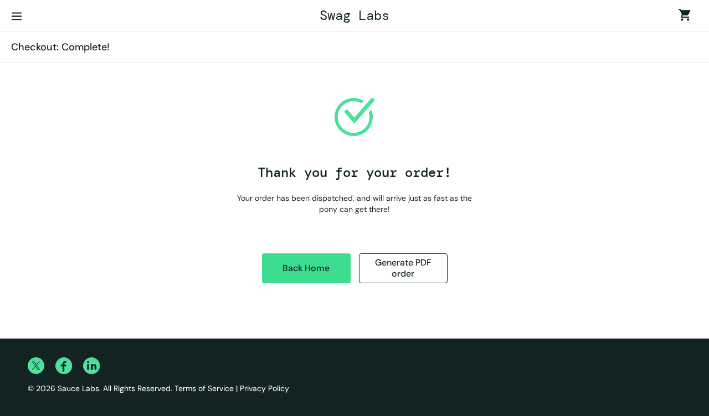
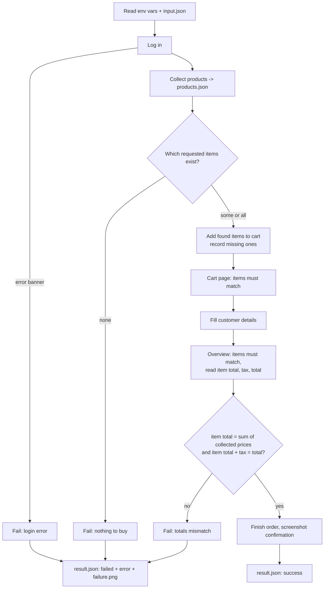
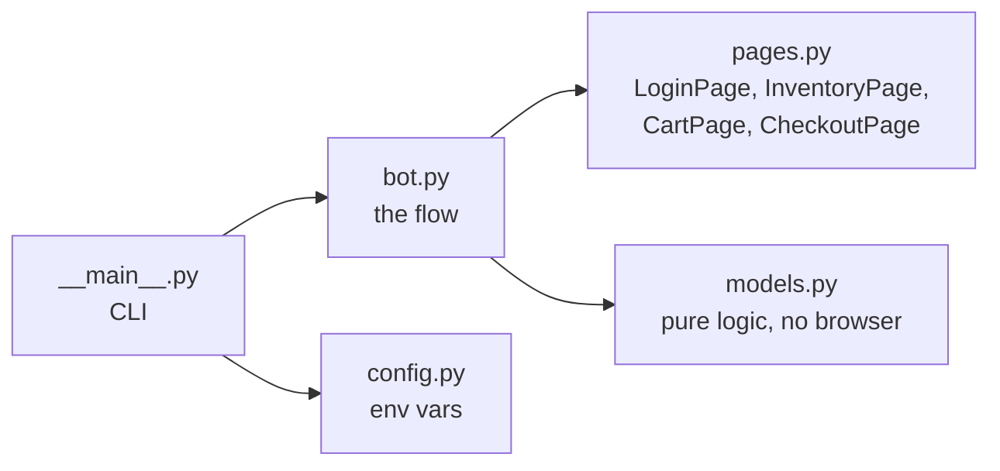

# Saucedemo checkout bot (Bravebird RPA take-home)

A Python + Playwright bot that logs in to [saucedemo.com](https://www.saucedemo.com), collects the product catalogue, buys the items on a shopping list, verifies the order totals, and writes a clear result file. It works unchanged for `standard_user` and the slow `performance_glitch_user`.



Demo video of a full run as `performance_glitch_user` (about 14 s): [demo/demo.mp4](demo/demo.mp4)

## Quick start

```bash
./scripts/setup.sh                 # venv, dependencies, Chromium
source .venv/bin/activate
export SAUCE_USERNAME=standard_user
export SAUCE_PASSWORD=secret_sauce  # public demo password shown on the site's home page
python -m saucebot                  # reads input.json, writes outputs/
```

On Windows (PowerShell 5.1+) use the `.ps1` equivalents:

```powershell
.\scripts\setup.ps1                              # venv, dependencies, Chromium
.\scripts\run.ps1                                # standard_user, writes outputs\
.\scripts\run.ps1 performance_glitch_user --headed
.\scripts\test.ps1                               # all tests (-UnitOnly for the fast ones)
```

If PowerShell blocks scripts, run `Set-ExecutionPolicy -Scope Process -ExecutionPolicy Bypass` first.

Other ways to run:

| Command | What it does |
| --- | --- |
| `./scripts/run.sh performance_glitch_user` | Same run as the slow user |
| `python -m saucebot --headed` | Watch the browser |
| `python -m saucebot --demo-video demo/` | Slow motion run, records a video |
| `python -m saucebot --input other.json --out some/folder` | Custom input and output folder |
| `python -m pytest` | Unit tests plus live end-to-end tests (`SKIP_E2E=1` for unit only) |

The exit code is `0` on success, `1` if the run failed, `2` if configuration is missing.

## Input and output

`input.json` (as in the brief):

```json
{
  "items": ["Sauce Labs Backpack", "Sauce Labs Onesie", "Sauce Labs Water Bottle"],
  "customer": {"first_name": "Ada", "last_name": "Lovelace", "zip": "94105"}
}
```

Each run writes to `outputs/`:

| File | Content |
| --- | --- |
| `products.json` | Every product: name, description, price as a number |
| `result.json` | `status`, `requested_items`, `ordered_items`, `missing_items`, `totals`, `confirmation_message`, `error` |
| `confirmation.png` | Screenshot of the order confirmation page |
| `failure.png` | Only on a failed run: what the page looked like when it failed |

The committed `outputs/` folder is one real run as `standard_user`; `outputs/performance_glitch_user/` is the same run as the slow user. The result from that run:

```json
{
  "status": "success",
  "requested_items": ["Sauce Labs Backpack", "Sauce Labs Onesie", "Sauce Labs Water Bottle"],
  "ordered_items": ["Sauce Labs Backpack", "Sauce Labs Onesie"],
  "missing_items": ["Sauce Labs Water Bottle"],
  "totals": {"item_total": 37.98, "tax": 3.04, "total": 41.02},
  "confirmation_message": "Thank you for your order!",
  "error": null
}
```

## How it works



Code layout:



- `models.py` holds everything that does not need a browser: price parsing, input validation, the found/missing split and the totals check. These are covered by fast unit tests.
- `pages.py` has one small class per page. Each method waits for the page state it needs.
- `bot.py` reads top to bottom as the story of a run, and always writes `result.json`.

### How the requirements are met

| Requirement | Where and how |
| --- | --- |
| Credentials from env vars | `config.py`: `SAUCE_USERNAME`, `SAUCE_PASSWORD`. Missing values stop the run with a clear message. |
| No fixed sleeps | Only Playwright waits on state: a visible element, a URL, or a result-or-error race after login. There is no `sleep` or `wait_for_timeout` in the code. |
| Works as `performance_glitch_user` | Login waits for "inventory or error banner" with a 30 s cap (`SAUCE_TIMEOUT_MS` to change). The slow login takes about 5 s, a fast one 0.1 s, with no code change. |
| Missing item | Exact name match only. Missing items go to `missing_items`, the rest are bought. If none exist the run fails and nothing is bought. |
| Item total check | `Decimal` math. Item total must equal the sum of the collected prices of the items actually ordered, and item total + tax must equal total. A mismatch fails the run before the order is placed. |
| Failures are visible | Every failure becomes `status: failed` with an `error` message, a `failure.png`, and a non-zero exit code. Timeouts, bad logins (for example `locked_out_user`), a bad input file and unexpected errors are all covered. |

Design choices worth knowing:

- A page URL changes before the new view has rendered. The first version of this bot read the cart straight after the URL change and saw the inventory list instead. It now also waits for the cart list and the checkout summary to be visible, and reads item names only inside them. A test run of both users five times each is stable.
- The bot checks that the cart and the overview page contain exactly the expected items before it trusts the totals.
- Duplicate names in the shopping list count once, because the shop allows one of each item per cart.
- Matching is case-sensitive and exact. A near match is reported as missing, not guessed.

## Running against 40 different websites

Today the site details (selectors, URLs, steps) sit in `pages.py`. For 40 sites I would keep the runner and result format, and change what varies:

1. **Site adapters.** Put each site behind one small interface (`login`, `list_products`, `add_to_cart`, `checkout`, `read_totals`). The flow in `bot.py` stays the same. Most of the 40 sites should share a few templates (the same shop platform), so each adapter is mostly a small config file of selectors and URLs, not new code.
2. **Stable locators.** Prefer roles, labels and test ids over CSS paths, and keep fallbacks per field. Locators live in config, so fixing a site after a redesign is a one-file change.
3. **Config and secrets per site.** One config file per site and credentials from a secrets store (never in the repo), injected as env vars at run time.
4. **Parallel, isolated runs.** One browser context per site and per run, run through a queue with a concurrency cap and a per-site rate limit. Retry only transient failures (network, timeouts), never business failures such as a totals mismatch.
5. **Observability.** Same `result.json` shape for every site, plus a screenshot and a Playwright trace on failure, structured logs and one dashboard: success rate and run time per site.
6. **Detect breakage early.** A scheduled canary per site that runs everything except the final purchase, and alerts when a locator or flow stops working, so the 40 sites do not break silently.
7. **Hard cases.** Captchas, logins with MFA and bot detection need a human or a service in the loop; those sites are flagged and handled separately instead of blocking the other 39.

## Tests

```bash
python -m pytest           # 9 tests
```

- Unit tests (`tests/test_models.py`): price parsing, missing-item split, totals checks, input validation.
- Live tests (`tests/test_e2e.py`): full run for `standard_user` and `performance_glitch_user`, `locked_out_user` failing clearly, all items missing, and a broken input file.

CI (GitHub Actions) runs the unit tests and, in a second job, the live end-to-end tests on every push.

## Project layout

```
saucebot/        config.py, models.py, pages.py, bot.py, __main__.py
tests/           unit and live tests
scripts/         setup.sh, run.sh
input.json       the example shopping list
outputs/         one real run (standard_user) + performance_glitch_user subfolder
demo/demo.mp4    screen recording of a full run
```
